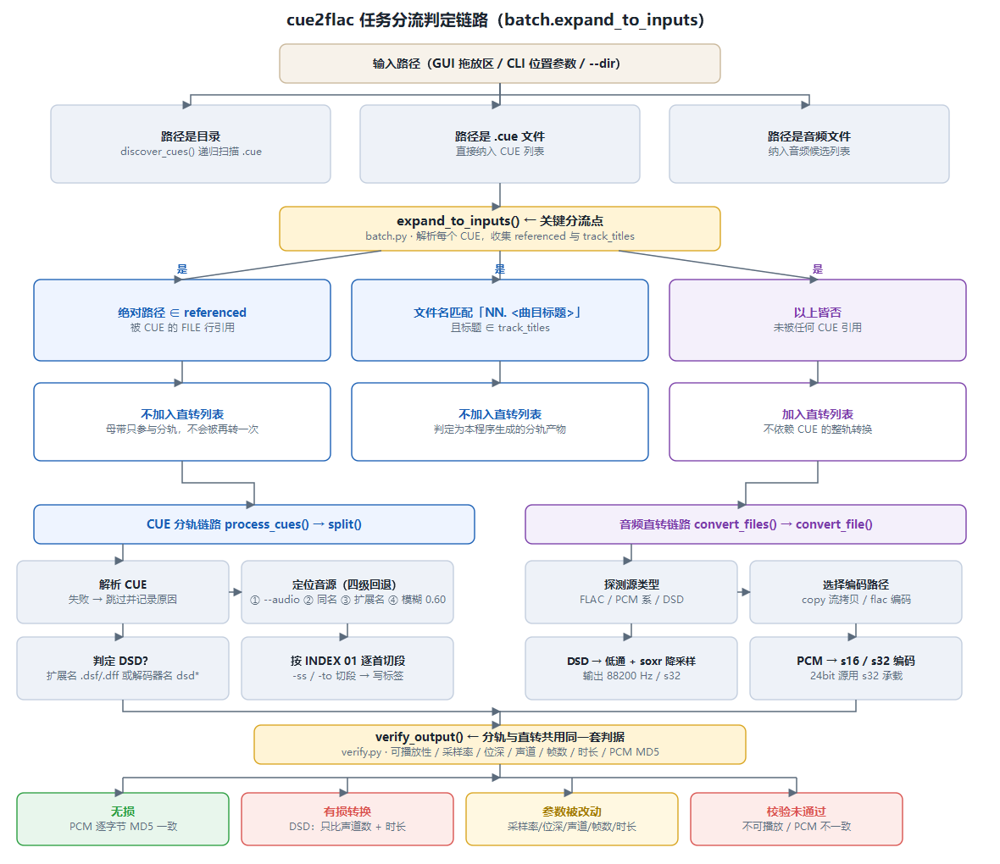
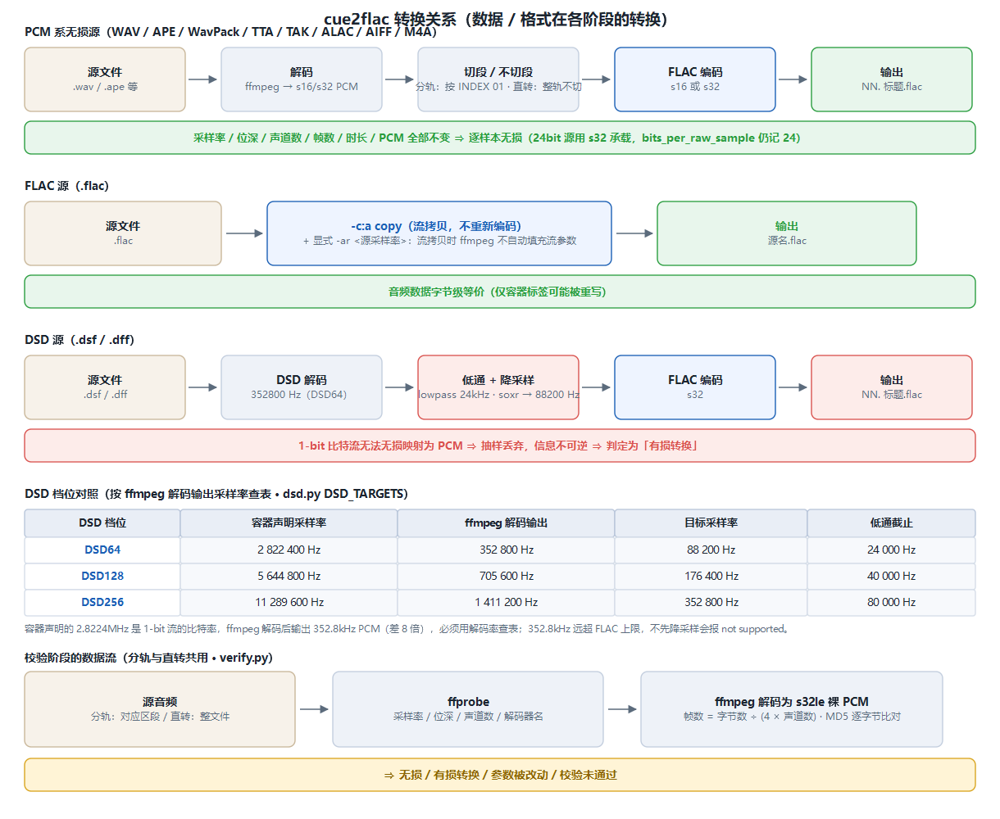
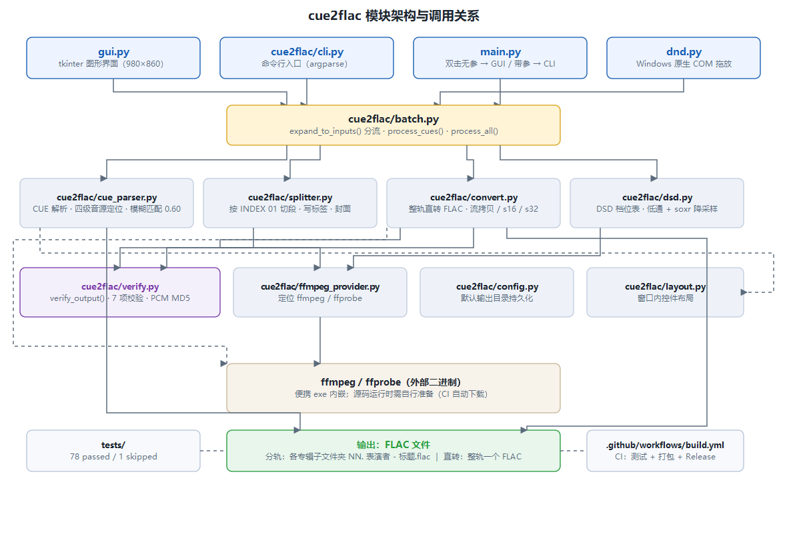
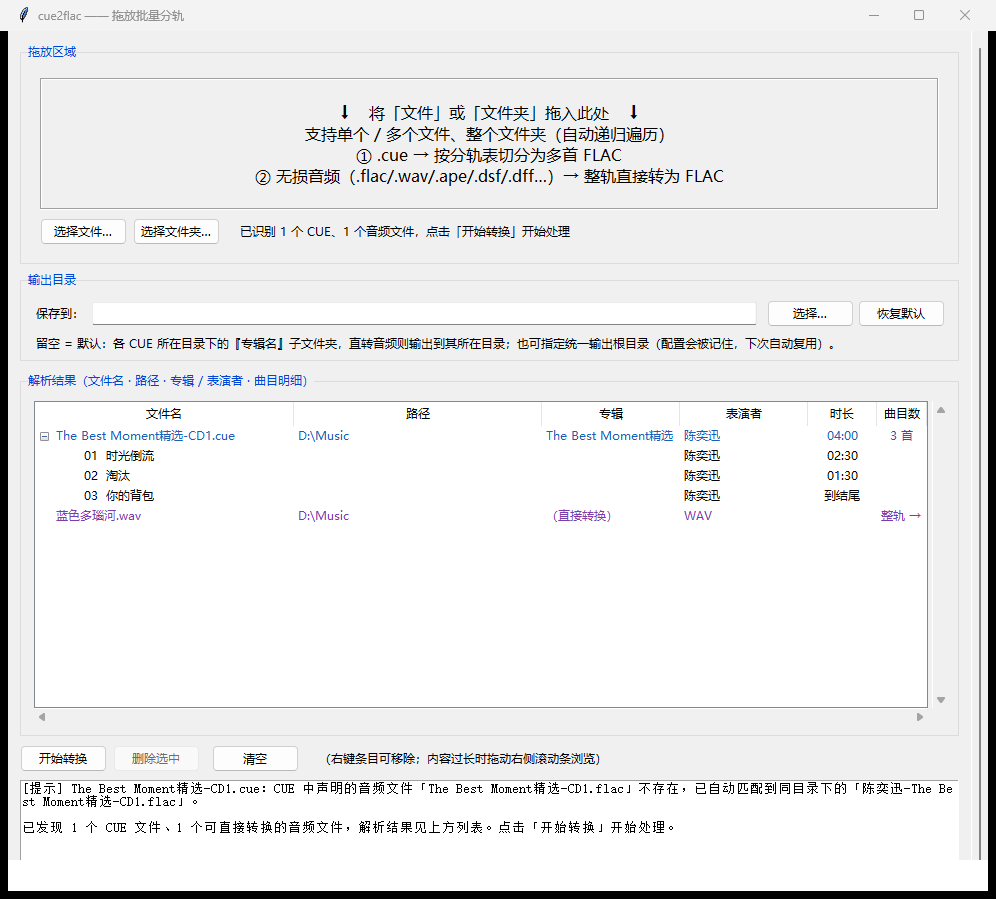

# cue2flac

> 根据 CUE 分轨文件，把整轨无损音频（FLAC / WAV / APE / DSD(.dsf/.dff) / WavPack / TTA / TAK / M4A / …）按曲目拆分为多首独立 FLAC 曲目。
> 便携、跨平台，可打包为**双击即用的单文件 exe（已内嵌 ffmpeg/ffprobe，无需安装任何环境）**。

---

## 目录

- [特性](#特性)
- [工作原理（无损链路）](#工作原理无损链路)
  - [输入格式支持矩阵（分轨链路）](#输入格式支持矩阵分轨链路)
  - [判定链路（分支流转）](#判定链路分支流转)
  - [转换关系（数据 / 格式在各阶段的转换）](#转换关系数据--格式在各阶段的转换)
  - [模块架构](#模块架构)
- [下载与安装](#下载与安装)
- [使用](#使用)
  - [图形界面（单一拖放区）](#图形界面单一拖放区)
  - [不依赖 CUE 的直接转换](#不依赖-cue-的直接转换)
  - [批量处理（扫描整个文件夹）](#批量处理扫描整个文件夹)
  - [命令行](#命令行)
- [输出文件与文件夹命名规则](#输出文件与文件夹命名规则)
- [输出验证（无损判定与参数校验）](#输出验证无损判定与参数校验)
- [配置持久化](#配置持久化)
- [项目结构](#项目结构)
- [从源码打包为便携 exe](#从源码打包为便携-exe)
- [开发与测试](#开发与测试)
- [License](#license)

---

## 特性

- **无损分轨**：整轨音频解码为 PCM → 按 CUE 的 `INDEX 01` / 下一条 `INDEX 01` 切出区段 → FLAC 编码器重新封装。只要不改变采样率与位深，输出 PCM 与源对应区段**逐样本一致**（校验默认开启，逐项比对采样率 / 位深 / 声道数 / 帧数 / 时长 / PCM）。
- **多格式输入**：凡 ffmpeg 支持的整轨音频均可，包括但不限于 FLAC、WAV、APE、**DSD（.dsf / .dff）**、WavPack（.wv）、TTA、TAK、M4A。
  - **PCM 源码（FLAC / WAV / APE / WavPack / TTA / TAK / M4A）**：解码 → 切段 → FLAC 重新封装，输出 PCM 与源区段**逐样本一致**，是真正的无损分轨（校验默认开启）。
  - **DSD 源码（.dsf / .dff）**：DSD 是 1-bit 德尔塔-西格玛编码，无法逐样本映射为 PCM/FLAC，因此 DSD → FLAC 属于**高质量转换而非逐样本无损**；程序按业界标准做法做「低通滤波 + 抽取降采样」（DSD64 → 88.2kHz / 24-bit），并在日志与结果汇总中明确标注为「有损转换」。输出文件可正常播放，但与原始 DSD 比特流不存在「逐字节一致」关系。
- **CUE 兼容**：自动识别 `INDEX 00/01`、`PERFORMER` / `TITLE`（专辑级与曲目级）、`REM GENRE/DATE/COMMENT`、`FILE` 指向；支持 GBK / UTF-8(-SIG) / Shift-JIS / CP1252 / Latin-1 多种编码自动探测。
- **音源自动匹配**：CUE 里 `FILE` 写的文件名与磁盘实际文件不一致时（如 CUE 写 `Album-CD1.ape`、实际文件叫 `陈奕迅-Album-CD1.ape`），会按名称相似度自动匹配到正确文件并在日志中提示。
- **无需 CUE 的直转**：**不依赖 CUE**，直接把单个或多个整轨无损音频（`.flac` `.wav` `.ape` `.dsf` `.dff` `.wv` `.tta` `.tak` `.alac` `.aiff`）转换为 FLAC，一个源文件对应一个 FLAC。
- **元数据保留**：专辑名、曲目名、表演者、流派、年份、曲目序号（`NN/总数`）写入每个 FLAC；源文件内嵌的封面会自动复制（可用 `--no-cover` 关闭）。
- **两种用法**：图形界面（双击即用，单一拖放区）与命令行（适合批量 / 脚本）。
- **批量处理**：把一个文件夹（可递归子目录）丢进去，自动发现其中**全部 `.cue`**，逐个解析并分轨；解析失败 / 音频缺失的会**跳过并记录原因**，最后给出**成功与跳过的汇总**。
- **纯净输出**：文件名形如 `01. 曲目名.flac`（有表演者时为 `01. 表演者 - 曲目名.flac`），自动清理非法字符。
- **响应式界面**：窗口缩放时，文字自动换行、按钮自动折行，内容过长可滚动到达，不会被裁切或“消失”。

---

## 工作原理（无损链路）

```
整轨音频 → ffmpeg 解码为 PCM → 取 [INDEX 01, 下一条 INDEX 01) 区段 → FLAC 编码器重新封装
```

FLAC 是无损压缩，对 PCM 做有损重编码在技术上不可能；因此“解码整轨 → 用 FLAC 编码重新封装”得到的 PCM 与直接从源文件取对应区段完全一致。校验会对“源对应区段”与“输出文件”各自解码为 `s32le` 裸 PCM 求 MD5，确保分轨结果逐字节无损、无截断，并逐项比对采样率 / 位深 / 声道数 / 帧数 / 时长。

> **DSD 例外**：当源为 `.dsf` / `.dff`（1-bit DSD）时，上述链路是「DSD → 低通滤波 → 抽取降采样 → 32-bit PCM → FLAC」。DSD→PCM 这一步本身不可逆、非逐样本无损，故 DSD 源的校验仅能证明「切分过程未额外丢损」，不能证明与原始 DSD 比特流逐字节一致；程序会将其明确标注为「有损转换」。这是格式本质差异，并非程序缺陷。

### 输入格式支持矩阵（分轨链路）

下表列出各无损格式经 CUE 分轨后的**实际行为**，均已用真实文件实测验证：

| 格式 | 扩展名 | 分轨是否可用 | 输出参数 | 无损性质 |
|---|---|---|---|---|
| WAV | `.wav` | ✅ | 与源一致（采样率 / 位深 / 声道数） | **逐样本无损**（PCM MD5 一致） |
| FLAC | `.flac` | ✅ | 与源一致 | **逐样本无损** |
| APE | `.ape` | ✅ | 与源一致 | **逐样本无损** |
| DSD | `.dsf` | ✅ | 88200 Hz / 24-bit / 立体声（DSD64） | **高质量转换**（非逐样本无损） |
| DSD | `.dff` | ✅ | 88200 Hz / 24-bit / 立体声（DSD64） | **高质量转换**（非逐样本无损） |

- **WAV / FLAC / APE**：解码后按 `INDEX 01` 切段再重新封装，采样率、位深、声道数、帧数、时长全部与源对应区段一致，PCM 逐字节相同。
- **24bit WAV**：用 `s32` 承载 24 位有效数据，FLAC 记录 `bits_per_raw_sample=24`，**不会被静默降为 16bit**。
- **DSD**：解码率为 352.8kHz（DSD64），远超 FLAC 编码器上限，程序自动做「低通 24kHz + soxr 降采样至 88.2kHz」，输出 32-bit FLAC；每首**时长精确**（切割定位准确），但因 DSD→PCM 不可逆，明确标注为「有损转换」。
- 其它 ffmpeg 能解码的格式（WavPack / TTA / TAK / ALAC / AIFF / M4A 等）同样可用，行为与 PCM 系一致。

### 判定链路（分支流转）

程序对每个输入的处理都遵循同一条判定主干：**先分流（CUE 分轨 / 音频直转），再定格式路径（PCM / DSD / FLAC 流拷贝），最后统一校验**。下图中的分支条件与代码一一对应。



<details>
<summary>展开查看文字版流程图（便于在纯文本环境阅读）</summary>

```
输入路径（GUI 拖放区 / CLI 位置参数 / --dir）
  │
  ├─ 路径是目录 ──▶ discover_cues() 递归扫描全部 .cue
  │                 discover_audio_files() 扫描全部受支持音频
  │
  ├─ 路径是 .cue 文件 ──▶ 直接纳入 CUE 列表
  │
  └─ 路径是音频文件 ──▶ 纳入音频候选列表
        │
        ▼
   expand_to_inputs()  ← 关键分流点（batch.py）
        │
        ├─ 解析每个 CUE（parse_cue），收集：
        │    · referenced  ← 被 CUE 的 FILE 行引用、解析后的绝对路径
        │    · track_titles ← CUE 中的曲目标题集合
        │
        └─ 对每个音频候选逐一判定：
             │
             ├─ 绝对路径 ∈ referenced
             │     → 【不加入直转列表】它就是这张专辑的母带，
             │       只参与分轨，不会被再转一次
             │
             ├─ 文件名匹配「NN. <曲目标题>」且标题 ∈ track_titles
             │     → 【不加入直转列表】判定为本程序先前生成的分轨产物
             │
             └─ 以上皆否 → 加入直转列表（不依赖 CUE 的整轨转换）
        │
        ▼
   ┌──────────────────────┴──────────────────────┐
   │                                             │
 CUE 分轨链路                                  音频直转链路
 process_cues() → split()                     convert_files() → convert_file()
   │                                             │
   ├─ 解析失败（编码/语法错误、无 TRACK）           ├─ 源是 DSD？（扩展名 .dsf/.dff
   │   → 跳过该 CUE，记录原因                        │   或 ffprobe 解码器名以 dsd 开头）
   │                                               │      ├─ 是 → DSD 路径
   ├─ 音源文件不存在                                │      └─ 否 → PCM 路径
   │   → 跳过该 CUE，列出同目录候选音频              │
   │                                               │
   ├─ 定位音源（_resolve_audio，四级回退）：        │
   │    ① --audio 显式指定的文件                   │
   │    ② CUE 目录下的同名文件                      │
   │    ③ 同主干 + 各扩展名回退                     │
   │    ④ 模糊匹配（阈值 0.60，扩展名一致加权）      │
   │                                               │
   ├─ 判定 DSD？（扩展名或解码器名）                │
   │    ├─ 是 → 低通 + 降采样 + s32（见转换图）       │
   │    └─ 否 → 探测位深 → s16 / s32                │
   │                                               │
   └─ 按 INDEX 01 逐首切段 → 写标签 → 校验           │
        │                                          │
        └──────────────┬───────────────────────────┘
                       ▼
        verify_output() ← 分轨与直转共用同一套判据
                       │
        ┌──────────────┴──────────────┐
        │                             │
   7 项校验全部通过                任一项不通过
        │                             │
        ▼                             ▼
   判定结论（status）              该 CUE / 该文件判为失败
        ├─ 无损（lossy_reason 为空）
        ├─ 有损转换（DSD：只比声道数 + 时长，标注低通截止与目标采样率）
        ├─ 参数被改动（采样率/位深/声道/帧数/时长 有差异）
        └─ 校验未通过（不可播放 / PCM 不一致）
```

</details>

命令行还有一层更早的入口分流（`cli.main`）：位置参数里含目录或指定了 `--dir` → 批量模式；只给一个 `.cue` → 单 CUE 模式；其余（多个 CUE / 音频 / 混合）→ 混合模式。三种模式最终都收敛到 `process_all()`，即上图这条主干。

### 转换关系（数据 / 格式在各阶段的转换）

下图说明**同一个源文件在不同判定分支下，数据与格式在各阶段如何变化**。方括号内为代码位置。



<details>
<summary>展开查看文字版转换图（便于在纯文本环境阅读）</summary>

**PCM 系无损源**（WAV / APE / WavPack / TTA / TAK / ALAC / AIFF / M4A）：

```
源文件                解码                切段 / 不切段           FLAC 编码            输出
.wav / .ape   ──▶  ffmpeg 解码  ──▶  分轨：按 INDEX 01 切    ──▶  flac 编码器   ──▶  NN. 标题.flac
（PCM 系）      [s16 / s32 PCM]      直转：整轨不切                    [s16 或 s32]
                    │                      │                          │
                    │                      │                          └─ 24bit 源用 s32 承载
                    │                      │                             （FLAC 仅接受 s16/s32，
                    │                      │                              bits_per_raw_sample 仍记 24）
                    │                      │
                    └──────────────────────┴──▶ 采样率 / 位深 / 声道数 / 帧数 / 时长 / PCM 全部不变
                                                                        ⇒ 逐样本无损
```

**FLAC 源**（`.flac`）：

```
源文件                处理                                输出
.flac          ──▶  -c:a copy（流拷贝，不重新编码）  ──▶  源名.flac
                 + 显式 -ar <源采样率>（流拷贝时 ffmpeg
                   不自动填充输出流参数，缺省会报
                   "sample rate not set / Could not write header"）
                   ⇒ 音频数据字节级等价（仅容器标签可能被重写）
```

**DSD 源**（`.dsf` / `.dff`）：

```
源文件              解码                 低通 + 降采样            FLAC 编码            输出
.dsf / .dff  ──▶  ffmpeg DSD 解码器  ──▶  lowpass + soxr   ──▶  flac (s32)   ──▶  NN. 标题.flac
                    352800 Hz (DSD64)      → 88200 Hz
                                           24kHz 截止
                    ▲ 1-bit 比特流         ▲ 抽样丢弃，          ⇒ 采样率改变
                      无法无损映射为 PCM     信息不可逆              ⇒ 判定为「有损转换」
```

DSD 档位对照（按 **ffmpeg 解码输出采样率**查表，`dsd.py` 的 `DSD_TARGETS`）：

| DSD 档位 | 容器声明采样率 | ffmpeg 解码输出 | 目标采样率 | 低通截止 |
|---|---|---|---|---|
| DSD64 | 2 822 400 Hz | 352 800 Hz | 88 200 Hz | 24 000 Hz |
| DSD128 | 5 644 800 Hz | 705 600 Hz | 176 400 Hz | 40 000 Hz |
| DSD256 | 11 289 600 Hz | 1 411 200 Hz | 352 800 Hz | 80 000 Hz |

> 容器声明的 2.8224MHz 是 **1-bit 流的比特率**，ffmpeg 解码后输出 352.8kHz PCM（相差 8 倍），因此**必须用解码率而非容器率查表**。352.8kHz 远超 FLAC 编码器上限，不先降采样会直接报 `352800 Hz not supported`。分轨与直转两条链路调用同一个 `dsd_plan()`，行为完全一致。

**校验阶段的数据流**（分轨与直转共用，`verify.py`）：

```
源音频（分轨：对应区段 / 直转：整文件）
  │
  ├─▶ ffprobe ─▶ 采样率 / 位深 / 声道数 / 解码器名
  │
  ├─▶ ffmpeg 解码为 s32le 裸 PCM ─┐
  │                               ├─▶ 帧数 = s32le 字节数 ÷ (4 × 声道数)
  │                               └─▶ MD5 ──▶ 逐字节比对
  │
  └─▶ ffmpeg 解码输出流信息 ─▶ 解码后真实采样率（用于时长换算）

⇒ 无损 / 有损转换 / 参数被改动 / 校验未通过
```

</details>

### 模块架构

下图按调用层次展示各模块的职责与依赖关系。



---

## 下载与安装

### 方式一：直接使用便携 exe（推荐）

前往 **Releases** 页面下载 `cue2flac.exe`，双击即可运行（已内嵌 ffmpeg/ffprobe，不依赖任何外部环境）。

- **双击（无参数）** → 启动图形界面，把文件夹或 `.cue` 文件拖入「拖放区域」，预览解析结果后一键转换。
- **命令行**（在终端里运行） → 见[命令行](#命令行)一节。

> 便携 exe 是“控制台构建”：双击进入 GUI 时，`main.py` 会自动隐藏启动用的黑框，保持体验干净；带参数走 CLI 时则保留控制台以显示进度与错误。

### 方式二：从源码运行

```bash
# 需要 Python 3.9+（CI 构建使用 3.11），并自行准备 ffmpeg / ffprobe
#   —— 放到 PATH 中，或放到项目根目录的 ffmpeg/ 文件夹下
pip install -r requirements.txt

python main.py            # 启动图形界面
python main.py album.cue  # 命令行分轨
```

---

## 使用

### 图形界面（单一拖放区）



> 窗口可自由缩放：拖放提示、状态栏、输出说明等文字会在方框变窄时**自动换行**；按钮在宽度不足时**自动折行**；内容过长时通过**可滚动**面板（结果列表自带滚动条，整体内容另有右侧滚动条）到达，不会因尺寸缩小而裁切或“消失”。

1. 把 **文件夹** 或 **一个或多个 `.cue` / 无损音频文件** 直接拖进窗口顶部的「拖放区域」；也可点击「**选择文件…**」/「**选择文件夹…**」按钮（非 Windows 下为回退入口）。
2. 程序自动解析路径、**递归遍历**，并在下方「解析结果」列表中展示：
   - `.cue` 文件 → 每个 CUE 一行（文件名 / 路径 / 专辑 / 表演者 / 曲目数），展开可见每首曲目的**序号 / 标题 / 表演者 / 时长**（解析失败的也会列出并标注原因）；
   - 无损音频文件 → 单独一行（紫色标注「（直接转换）」），表示**不依赖 CUE**、整轨直接转成一个 FLAC。
   - 不需要的条目可**右键点击**该条目（或选中后点「**删除选中**」/ 按 `Delete` 键）将其从解析结果中移除；内容过长时拖动结果面板**右侧的滚动条**即可顺畅浏览。
3. （可选）在「**输出目录**」栏设置统一输出位置：点「**选择…**」挑一个文件夹作为所有专辑的统一根目录；留空则使用**默认行为**——分轨输出到各 CUE 所在目录下的 `<专辑名>` 子文件夹，直转输出到各音频所在目录；点「**恢复默认**」可清除自定义选择。该选择会被记住，下次启动自动复用（见[配置持久化](#配置持久化)）。
4. 确认解析结果无误后，点击「**开始转换**」，程序即依据各 CUE 信息对相关音频进行无损分轨，并对直转条目执行整轨转换（输出到上述目录）。
5. 完成后弹出汇总，底部日志区列出成功项与跳过项及原因，并附「输出校验汇总」（每首逐项校验：可播放 / 采样率 / 位深 / 声道数 / 帧数 / 时长 / PCM 逐字节一致，标注 ✓ 或 ✗ 及原因，并给出源→输出参数对照）。**校验默认开启**，任一首未通过则该 CUE 被跳过；弹窗会单独列出有损转换与参数被改动的文件。

> 拖放支持单个文件、多个文件与整个文件夹；拖入时区域高亮（橙），放下成功闪绿、未找到可处理内容闪红。
>
> **母带不会被重复转换**：若某个音频文件已被同目录的 CUE 引用为整轨母带，它只参与分轨，不会再单独转一次。

### 不依赖 CUE 的直接转换

除了按 CUE 分轨，程序还支持**完全不用 CUE**：直接把整轨无损音频转成 FLAC，一个源文件对应一个 FLAC 文件。

**图形界面**：把音频文件（或含音频的文件夹）拖进拖放区域，它们会以紫色「（直接转换）」条目出现在列表中，点「开始转换」即可。

**命令行**：

```bash
# 单个文件直转（输出到源文件所在目录）
python main.py "D:/Music/专辑.flac"

# 多个文件一起转，指定统一输出目录
python main.py "D:/Music/a.ape" "D:/Music/b.wav" -o "D:/Music/FLAC"

# 目录模式：其中未被 CUE 引用的音频会被直接转换
python main.py --dir "D:/Music/整轨"
```

支持的输入格式与各自的性质：

| 格式 | 扩展名 | 转换性质 | 说明 |
|---|---|---|---|
| FLAC | `.flac` | **完全等价** | 走流拷贝，不重新编码 |
| WAV | `.wav` | **逐样本无损** | PCM 解码后重新封装，MD5 一致 |
| APE | `.ape` | **逐样本无损** | Monkey's Audio 解码后重新封装，MD5 一致 |
| WavPack / TTA / TAK / ALAC / AIFF | `.wv` `.tta` `.tak` `.alac` `.aiff` | **逐样本无损** | 同上 |
| DSD | `.dsf` `.dff` | **高质量转换**（非逐样本无损） | 见下方说明 |

**关于 DSD 的边界**（重要）：DSD 是 1-bit 德尔塔-西格玛编码，其比特流**无法**无损映射为 PCM 样本。因此 `.dsf` / `.dff` 转 FLAC 属于**高质量转换，而非逐样本无损**。程序按业界标准做法处理：先低通滤波截止掉 DSD 的超声频量化噪声（DSD64 截止 24kHz、DSD128 截止 40kHz），再抽取降采样（DSD64 → 88.2kHz、DSD128 → 176.4kHz），输出 32-bit FLAC。这一步在日志与结果汇总中会**明确标注**，不会被混称为「无损」。

> **DSD 采样率的事实**：DSD64 容器声明 2.8224MHz，但那是 **1-bit 比特率**；ffmpeg 解码后输出的是 **352.8kHz PCM**（两者相差 8 倍）。352.8kHz 远超 FLAC 编码器的采样率上限，**必须**先降采样才能编码——否则 ffmpeg 会直接报 `352800 Hz not supported` 而转换失败。程序对分轨与直转两条链路使用**完全相同**的 DSD 处理策略。

**位深保持**：FLAC 编码器只接受 `s16` / `s32` 两种采样格式。程序会自动探测源位深并选择合适的容器——**24bit 源用 `s32` 承载**（FLAC 记录的 `bits_per_raw_sample` 仍为 24），因此 24bit 母带不会被静默降为 16bit。输出文件的位深、采样率、声道数均与源一致。

### 批量处理（扫描整个文件夹）

当手头是一个装满整轨专辑的文件夹（含多层子目录）时，无需逐个挑选 CUE：

- **图形界面（推荐）**：直接在唯一的「**拖放区域**」把整个文件夹（或同时拖入多个 `.cue` 文件）拖进去，也可点「**选择文件夹…**」按钮。程序会递归遍历其中的**全部 `.cue`**，在「**解析结果**」列表中展示（每 CUE 一行：文件名 / 路径 / 专辑 / 表演者 / 曲目数，展开见每首明细），点击「**开始转换**」即可批量分轨。
- **命令行**：把目录作为位置参数，或用 `--dir` 指定：

```bash
# 递归扫描 D:/Music/整轨 下的全部 CUE 并分轨
python main.py "D:/Music/整轨"
python main.py --dir "D:/Music/整轨"

# 不递归子目录（仅处理该目录下的 .cue）
python main.py "D:/Music/整轨" --no-recursive

# 统一输出到一个根目录（每个专辑一个子文件夹）
python main.py --dir "D:/Music/整轨" -o "D:/Music/拆分结果"

# 批量时也支持 --audio / --no-cover / --no-verify
python main.py --dir "D:/Music/整轨" --no-verify
```

批量模式的行为：
- 自动发现目录（含子目录）下所有 `.cue`，**按小写路径排序、去重**后逐个处理；
- 逐个解析音轨元数据；解析失败（编码/语法错误、无 `TRACK`）或分轨失败（音频缺失等）的文件会**跳过**，并在汇总中附上原因；
- 目录中**未被任何 CUE 引用**的音频文件会被**直接转换**（不依赖 CUE）；已被引用为母带的音频只参与分轨，不会重复转换；
- 最终返回汇总：**扫描总数、成功数、跳过数**，以及成功列表与跳过列表（含原因）。

### 命令行

```bash
# 基本用法：按 CUE 拆分，输出到默认目录
python main.py "示例专辑.cue"

# 指定输出目录与音频文件
python main.py album.cue -o "D:/Music/拆分结果" -a "album.flac"

# 不复制封面 / 分轨后校验 PCM 无损
python main.py album.cue --no-cover

# 不依赖 CUE 的直接转换（可给多个路径）
python main.py "D:/Music/album.ape" "D:/Music/track.wav" -o "D:/Music/FLAC"
```

位置参数可同时接受 `.cue` 文件、无损音频文件与目录，程序会自动区分处理方式。

参数说明：

| 参数 | 说明 |
| --- | --- |
| `cue` | CUE 文件路径；也可传**目录**，自动批量扫描其中的 `.cue` 文件 |
| `-o, --out` | 输出目录；批量模式下作为统一输出根目录。**不指定时依次回退**：配置文件中的默认值 → 各 CUE 所在目录下的「专辑名」子文件夹 |
| `-a, --audio` | 指定整轨音频文件（覆盖 CUE 中 `FILE` 指向） |
| `--no-cover` | 不复制封面 |
| `--no-verify` | 跳过转换后的无损校验。**校验默认开启**（可播放性 / 采样率 / 位深 / 声道数 / 帧数 / 时长 / PCM 逐字节一致，并输出判定结果）；加此参数可省去全量解码耗时 |
| `--dir` | 要批量扫描的目录（等价于把目录作为位置参数传入） |
| `-r, --recursive` | 递归遍历子目录（默认开启） |
| `--no-recursive` | 不遍历子目录，仅处理指定目录下的 `.cue` |
| `-v, --version` | 显示版本号 |

---

## 输出文件与文件夹命名规则

### 输出文件夹
- **默认**（未指定 `-o` / 未设置配置默认值）：`<CUE 所在目录>/<专辑名>`
- **指定了统一输出目录 `<out>`**：`<out>/<专辑名>`
- **专辑名来源**：优先用 CUE 中的 `album_title` 字段；若没有则用 CUE 文件名（去扩展名）；个别单文件场景兜底为 `output`。
- **安全化**：把 `\ / : * ? " < > |` 以及回车/换行/制表符替换成 `_`，去掉首尾空格/点/下划线，为空时兜底 `output`，总长度截断到 120 字符。
- **防重名**：同一批处理内若出现完全相同的输出目录路径，第二个起自动加 `_1`、`_2` 后缀。

### 每首音轨文件
- **基本格式**：`NN. 标题.flac`（`NN` 为两位补零的序号，`01`、`02`…；标题取自 CUE，缺失时兜底 `Track NN`）。
- **去重优化**：若该曲目有表演者，则改用 `NN. 表演者 - 标题.flac`（仅当总长度 ≤ 120 字符时采用，否则退回 `NN. 标题`）。
- **安全化**：非法字符同样替换成 `_`，去首尾 `. _ 空格`，为空兜底 `TrackNN`，总长度截断到 120 字符。
- 后缀固定 `.flac`。

### 同时写入的标签（metadata，不是文件名）
`title`、`artist`（曲目 performer，缺失则用专辑 performer）、`album`、`genre`、`date`、`track=NN/总数`。

示例：CUE 文件 `D:\Music\Album A\album.cue`（`album_title="My Album"`，2 首）——默认输出到 `D:\Music\Album A\My Album\`，生成 `01. First Song.flac`、`02. Second Song.flac`；若指定 `out=E:\Out`，则输出到 `E:\Out\My Album\`。

---

## 输出验证（无损判定与参数校验）

转换完成后，程序对每个输出 FLAC 做**统一的逐项校验**（分轨与直转两条链路共用同一套判据）：

| # | 校验项 | 判据 |
|---|---|---|
| 1 | **可播放性** | `ffprobe` 能识别音轨，且 `ffmpeg` 能完整解码到 null（无报错） |
| 2 | **采样率** | 输出 == 源 |
| 3 | **位深** | 输出 == 源（FLAC 记 `bits_per_raw_sample`） |
| 4 | **声道数** | 输出 == 源 |
| 5 | **帧数** | 同采样率时，输出 == 源（**整数精确相等**） |
| 6 | **时长** | 输出 == 源（容差 1ms，抵抗浮点累积误差） |
| 7 | **PCM 逐字节** | 源与输出解码为 `s32le` 后 MD5 完全一致 |

### 判定结论

校验完成后会给出明确结论，而不是笼统的「成功 / 失败」：

| 结论 | 含义 |
|---|---|
| **无损** | 上述 7 项全部通过 —— 输出与源逐样本一致 |
| **参数被改动** | 采样率 / 位深 / 声道数 / 帧数 / 时长 任一与源不同，逐项列出差异 |
| **有损转换** | 源为 DSD（1-bit 编码）转 PCM，本质不可逆；会同时给出低通截止频率与目标采样率 |
| **校验未通过** | 可播放性或 PCM 一致性不通过（文件损坏 / 数据不一致） |

**帧数怎么算**：ffprobe 的 `nb_frames` 对 WAV / FLAC 均返回 `N/A`；`-count_frames` 的 `nb_read_frames` 统计的是解码包数而非采样帧数（实测同一段音频 WAV 报 44、FLAC 报 39，真实值 177600），不可用。程序改用**解码后的 s32le 字节数 ÷ (4 × 声道数)** 推算，与 MD5 比对同源，既精确又能真实反映截断。

**采样率取哪个值**：ffprobe 报告的是**容器**声明的采样率，而解码器实际输出的采样率可能不同 —— DSD 容器声明 2.8224MHz（这是 1-bit **比特率**），ffmpeg 解码后实际输出 352.8kHz PCM（相差 8 倍）。程序因此取 **ffmpeg 解码后的真实速率**来推算帧数与时长，否则时长会算错。

### 开关

- **图形界面**：「开始转换」默认开启校验，结果打印在底部日志区的「输出校验汇总」中（每首标注 ✓/✗ 及原因），并给出「采样率 / 位深 / 声道 / 帧数 / 时长」的源→输出对照；弹出提示框会单独列出**有损转换**与**参数被改动**的文件。
- **命令行**：**默认开启**；用 `--no-verify` 跳过。验证失败的音轨会让该 CUE 处理失败并在汇总中报错。

> 说明：FLAC 本身是无损压缩，对 PCM 做有损重编码在技术上不可能。校验的核心价值在于**确认整条处理链路（解码 → 切割 → 重新封装）没有引入截断、读错区段或参数漂移**，并对源文件本身是否完好给出反馈。DSD 是唯一的例外——1-bit 比特流无法无损映射为 PCM 样本，程序对此**如实标注为「有损转换」并给出转换参数**，绝不混称「无损」。

---

## 配置持久化

输出目录偏好写入配置文件，下次启动自动复用：

- **便携 exe**：与 `cue2flac.exe` 同目录的 `cue2flac_config.json`
- **源码运行**：用户配置目录 `~/.config/cue2flac/config.json`

读取失败或文件不存在时返回空配置，不影响主流程。GUI 中「选择…」写入、「恢复默认」清除。

---

## 项目结构

```
cue2flac/
├── cue2flac/              # 核心包
│   ├── cue_parser.py       # CUE 解析（多编码探测、时间码换算、音轨定位）
│   ├── splitter.py         # 分轨核心（ffmpeg 切片 + 元数据 + 文件名安全化）
│   ├── batch.py            # 批量扫描目录 / 汇总结果 / 输出目录防重名
│   ├── convert.py          # 不依赖 CUE 的整轨直转 FLAC（位深保持 / 无损校验）
│   ├── dsd.py              # DSD（.dsf/.dff）转换策略（低通 + 降采样，分轨与直转共用）
│   ├── verify.py           # 统一无损校验（可播放 / 参数 / 帧数时长 / PCM 逐字节）
│   ├── config.py           # 轻量配置持久化（默认输出目录）
│   ├── layout.py           # 按钮自动折行算法（纯函数，供 GUI 复用）
│   ├── ffmpeg_provider.py  # ffmpeg / ffprobe 定位（打包内嵌 / 本地 / PATH）
│   ├── cli.py              # 命令行入口
│   └── __init__.py         # 版本号等
├── gui.py                 # Tkinter 图形界面（单一拖放区 + 可滚动画布 + 响应式布局）
├── dnd.py                 # Windows 原生拖放支持（COM IDropTarget + ctypes，零依赖）
├── main.py                # 程序入口（有参数走 CLI，否则启动 GUI；双击自动隐藏黑框）
├── main.spec              # PyInstaller 规格（本地打包参考）
├── requirements.txt       # 运行/开发依赖
├── tests/                 # 单元测试与 GUI 冒烟测试
│   ├── test_cue_parser.py
│   ├── test_batch.py
│   ├── test_convert.py    # 直转测试（位深保持 / 无损 MD5 实证；需 ffmpeg）
│   ├── test_dsd.py       # DSD 分轨/直转测试（.dsf/.dff 端到端；需 ffmpeg）
│   ├── dsd_fixtures.py   # 构造真实 DSF / DFF 容器（ffmpeg 无 DSD 封装器）
│   ├── test_verify.py
│   ├── test_layout.py
│   ├── test_workflow.py   # CI 工作流静态校验（YAML / PowerShell 语法）
│   └── test_gui_smoke.py  # GUI 布局冒烟（需 tkinter；无显示环境自动跳过）
├── .github/workflows/     # 自动构建便携 exe 并发布到 Release
├── docs/                 # 文档配图（由脚本生成，内容与代码实现一致）
│   ├── gen_figures.py     # 流程图 / 架构图生成脚本（SVG 源）
│   └── images/            # 生成的图片：判定链路 / 转换关系 / 模块架构 / 界面截图
├── README.md
├── LICENSE
└── .gitignore
```

> **配图与代码的一致性**：`docs/gen_figures.py` 是配图的唯一来源，图中每个节点、分支条件与数值都直接对应源码实现（如 `DSD_TARGETS` 的三档采样率、`_EXT_FALLBACK` 的扩展名回退顺序、模糊匹配阈值 0.60、校验四态结论）。修改代码逻辑后重新运行该脚本即可同步更新配图：
>
> ```bash
> python docs/gen_figures.py        # 重新生成 SVG
> ```

---

## 从源码打包为便携 exe

仓库已包含 GitHub Actions（`.github/workflows/build.yml`）：推送 `main` 分支或手动触发，即可在 Windows runner 上自动下载 ffmpeg、打包并发布到 Release 与 Artifacts。本地手动打包命令与 CI 一致（**onefile 控制台构建，已内嵌 ffmpeg**）：

```bash
pip install pyinstaller
pyinstaller --noconfirm --onefile --name cue2flac ^
  --hidden-import cue2flac ^
  --hidden-import cue2flac.cli ^
  --hidden-import cue2flac.cue_parser ^
  --hidden-import cue2flac.splitter ^
  --hidden-import cue2flac.batch ^
  --hidden-import cue2flac.convert ^
  --hidden-import cue2flac.dsd ^
  --hidden-import cue2flac.config ^
  --hidden-import cue2flac.verify ^
  --hidden-import cue2flac.layout ^
  --hidden-import cue2flac.ffmpeg_provider ^
  --hidden-import tkinter ^
  --hidden-import dnd ^
  --add-binary "ffmpeg.exe;ffmpeg" ^
  --add-binary "ffprobe.exe;ffmpeg" ^
  main.py
```

> 注意：`--hidden-import` 必须包含 `config` / `verify` / `layout` / `convert` / `dsd` 等所有被动态导入或反射引用的子模块，否则打包后运行会因找不到模块而报错（缺少 `convert` 会导致「不依赖 CUE 的直接转换」功能在 exe 中不可用，缺少 `dsd` 会导致 DSD 源处理失败）。ffmpeg/ffprobe 通过 `--add-binary` 内嵌到 `ffmpeg/` 子目录下，由 `ffmpeg_provider.resolve_tool` 在运行时定位。

---

## 开发与测试

```bash
pip install -r requirements.txt   # 含 pytest 等
python -m pytest -q                # 运行全部测试
```

- `tests/test_cue_parser.py`、`test_batch.py`、`test_verify.py`、`test_splitter.py`：纯逻辑单测，无需界面即可运行。
- `tests/test_layout.py`：按钮折行算法的纯函数测试。
- `tests/test_gui_smoke.py`：GUI 布局冒烟（构造窗口、控件可见性、缩窄不裁切、滚动条可驱动画布等）；**需要 tkinter 与显示环境**，无显示环境时自动跳过。
- `tests/test_workflow.py`：工作流静态校验——YAML 可解析、步骤名无歧义冒号、`paths` 过滤未被误删、pwsh 步骤能被 PowerShell 解析器无错解析。
- CI 在打包前会跑 `test_layout.py`、`test_gui_smoke.py` 与 `test_workflow.py`，打包后还会做**多格式端到端分轨冒烟**：
  - 逐一断言 `wav / flac / ape / dsf / dff` 的 **ffmpeg 解码器可用**（分轨链路与格式无关，唯一格式相关项即解码器）；
  - 对 ffmpeg **能编码**的格式（wav、flac、wavpack、tta）生成真实样本并跑完整分轨，断言产出 2 首 FLAC；
  - 断言 CUE 解析出的音源与预期扩展名一致，避免「文件缺失时静默回退到同名其它格式」造成的假通过；
  - 另有批量扫描冒烟（成功 2 个专辑 / 跳过 1 个损坏 CUE）。

---

## License

[MIT](LICENSE)
